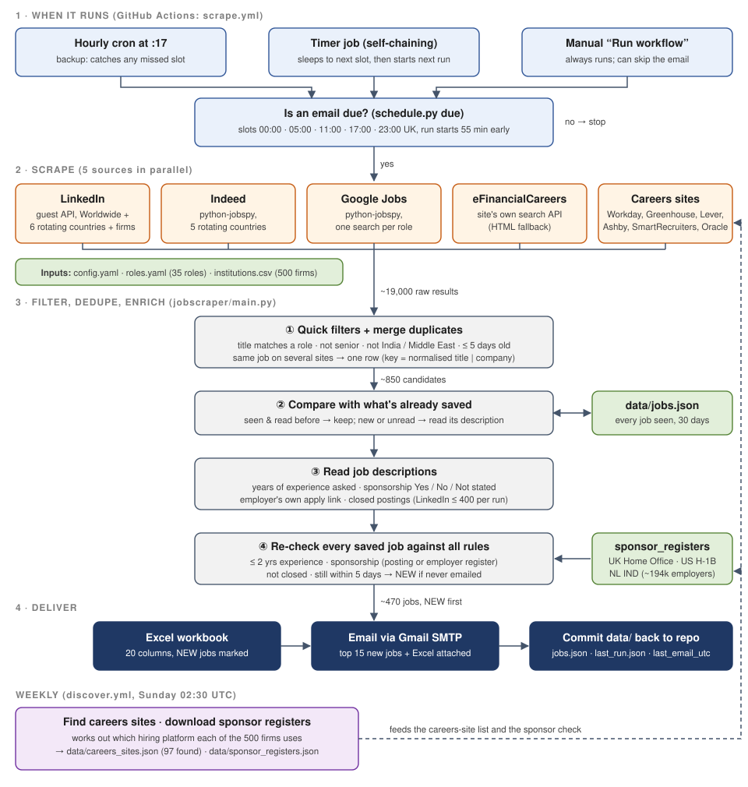

# Quant job scraper: architecture

This document explains how the quant job digest works: what triggers a run, where the jobs come
from, how they are filtered, how duplicates and already-sent jobs are handled, how visa
sponsorship is decided, and how the email goes out. File and function names refer to this
repository.

## In one paragraph

A GitHub Actions workflow wakes up shortly before each of five fixed UK times a day. It
searches LinkedIn, Indeed, Google Jobs, eFinancialCareers and the careers sites of the firms
in `institutions.csv` for the entry-level quant, risk and valuation roles in `roles.yaml`. It
drops anything senior, too old, in India or the Middle East, or without a route to visa
sponsorship, merges the same job found on several sites into one row, compares the result
with `data/jobs.json` to mark which jobs are new, and emails an Excel file of every matching
job from the last 5 days with the new ones first. It then commits `data/` back to the repo,
which is how the next run remembers what was already sent. There is no server and no
database: GitHub Actions is the computer and the git repo is the storage.

## Diagram



## Repository layout

| Path | What it is |
|---|---|
| `.github/workflows/scrape.yml` | The main workflow: due check, scrape, email, commit, and the timer that starts the next run |
| `.github/workflows/discover.yml` | Weekly workflow: finds careers sites and downloads the sponsor registers |
| `jobscraper/main.py` | The pipeline: plan searches, scrape, filter, dedupe, read descriptions, apply rules, write Excel, email |
| `jobscraper/schedule.py` | Works out whether an email is due and how long to wait for the next slot |
| `jobscraper/sources/*.py` | One module per job source |
| `jobscraper/filters.py` | Role matching, seniority, location, years of experience, recruiter and sponsorship text checks |
| `jobscraper/sponsor_registers.py` | Downloads and looks up the UK, US and Dutch sponsor registers |
| `jobscraper/discover_careers.py` | Finds which hiring platform each target firm uses |
| `jobscraper/institutions.py` | Loads `institutions.csv` and matches employer names to it |
| `jobscraper/models.py` | The `Job` record and its duplicate key |
| `jobscraper/excel.py`, `jobscraper/mailer.py` | The Excel workbook and the email |
| `jobscraper/http.py` | Shared HTTP session with random pauses and backoff |
| `config.yaml`, `roles.yaml`, `institutions.csv` | Everything you can tune without touching code |
| `data/` | State the workflow commits back after each run |

## 1. When it runs

### Email slots

`config.yaml` sets the times the email should arrive:

```yaml
email_times: ["00:00", "05:00", "11:00", "17:00", "23:00"]
email_timezone: Europe/London
run_lead_minutes: 55
```

Scraping takes 35 to 50 minutes, so each run starts 55 minutes before its slot (23:05, 04:05,
10:05, 16:05 and 22:05 UK time). Times are in UK local time, so they follow the clock change.

### Three ways a run starts

GitHub's built-in cron is unreliable for this repo and skipped many runs, so `scrape.yml` has
three triggers that all go through the same gate:

1. **Timer chain (the main mechanism).** After every run, the `timer` job calls
   `python -m jobscraper.schedule wait`, sleeps until the next run start time, then starts the
   workflow again with `gh workflow run scrape.yml -f chained=true`. Its concurrency group
   (`chain-timer`, cancel in progress) means only one timer is ever waiting.
2. **Hourly cron at :17 (the backup).** If the chain ever breaks, the next hourly run notices
   that a slot was missed, sends it, and its own timer restarts the chain.
3. **Manual "Run workflow".** Always runs. Unticking "Send the email" makes a dry run that only
   uploads the Excel file as a build artifact.

### The "is an email due?" gate

`schedule.py due` prints `true` when no email has gone out since the most recent run start
time. It compares `data/last_email_utc` (written after every successful send) with the latest
slot start. Scheduled and chained runs skip all scraping when this says `false`, so the hourly
cron costs only a few seconds when nothing is due. Before checking, the job pulls `main`, in
case another run emailed while this one was queued.

The scrape job shares the `job-digest` concurrency group with the weekly workflow, so two
scrapes never run at the same time and never race on `data/`.

> Earlier versions sent every 4 hours on GitHub's schedule, and then checked hourly for a due
> 4-hour slot. Both were replaced by the fixed UK times above. The 4-hour bucket survives only
> in the rotation counter (`slot = day * 6 + hour // 4`), which decides which countries and
> firms each run covers.

## 2. Data sources

`plan()` in `main.py` builds the list of searches for this run, grouped by site. Each site's
searches run one after another (so no site gets hammered), and the five sites run in parallel.
A failed search is logged and counted, and the run carries on.

| Source | How it is read | What is searched each run |
|---|---|---|
| **LinkedIn** | Public, logged-out "guest" job search endpoint, parsed with BeautifulSoup | Every role in Worldwide, plus 6 of 34 countries in rotation; experience levels Internship, Entry level and Associate; posted within 5 days; up to 3 pages per search. Also 80 target firms by name (those without a readable careers site), 2 pages each |
| **Indeed** | `python-jobspy` library | Every role in 5 of 29 countries in rotation, all of a role's keywords OR'd together, last 5 days, 30 results each |
| **Google Jobs** | `python-jobspy` library | One search per role title ("... entry level jobs in the last week"), 20 results each |
| **eFinancialCareers** | The JSON search API its own website uses, with an HTML fallback | Each role's keywords, 2 pages each |
| **Careers sites** | Each platform's public job API (Workday, Oracle, Greenhouse, Lever, Ashby, SmartRecruiters), 8 sites in parallel | Every firm in `data/careers_sites.json` (97 of the 500 at the last discovery), searched for risk, quant, valuation, product control, derivatives and trading terms |

**Rotation.** `rotate(items, per_run, slot)` takes a different slice of a list each run, so
the 34 LinkedIn countries, 29 Indeed countries and roughly 400 firms without a careers site
are all covered over a day or so without any single run getting too big.

**Politeness.** `http.polite_get` waits a random 1.5 to 3.5 seconds before each request,
rotates the browser user agent, and backs off on 429 and 5xx responses.

A recent run returned about 19,000 raw results: LinkedIn 8,500, careers sites 7,300,
eFinancialCareers 3,400, Indeed 34, Google Jobs 0. Google and Indeed often return little
because they block automated traffic; that is visible in the email footer and in
`data/last_run.json`.

## 3. Filtering

Filtering happens in two passes: a cheap pass on titles before anything is saved, and a full
rule check after descriptions have been read.

### Pass 1: quick filters (`apply_filters`)

A raw result is dropped when:

- it has no title or URL;
- it has no posting date (except LinkedIn, which already filters by date on its side) or was
  posted more than `max_age_days` (5) ago;
- **its title doesn't match a target role** (see below);
- **its title is too senior:** it contains a word from `senior_title_words` such as senior,
  lead, head, VP, director, manager, principal, or a level like II or III;
- **its location is excluded:** India and the Middle East, matched by country and city
  names from `excluded_locations`. A name ending in `$` (Oman, Jordan, Lebanon) only counts as
  the last part of the location, so "Amman, Jordan" is dropped and "Jordan, MN" is kept.

Survivors are tagged with their matched role, tier and category, and with the name of the
target institution if the employer is on `institutions.csv`.

### Role matching (`filters.RoleMatcher`)

Each keyword in `roles.yaml` becomes a set of "core" words:

1. Lowercase it, turn "P&L" into "pnl", and map synonyms (quantitative to quant, controller to
   control, valuations to valuation, and so on).
2. Remove generic words such as analyst, associate, junior, graduate, intern, programme.

A job title matches when it contains **all** the core words of some keyword. So "Graduate
Market Risk Analyst" matches the keyword "Market Risk Analyst" (core words: market, risk).
Keywords are tried most specific first, so a title matches "Market Risk Analyst" in
preference to the broader "Risk Analyst". A few single-word cores (credit, options, rates,
bond, margin, collateral, exposure, desk, pricing, valuation, trading, volatility) are too
loose alone, so for those the whole keyword phrase must appear in the title: "Credit Analyst"
matches, but "Credit Card Operations Analyst" does not.

There are 35 roles: 22 in Tier 1 (market risk, model risk and validation, product control
and valuation, derivatives and fixed income, buy side) and 13 in Tier 2 (quant, trading,
treasury and ALM, consulting).

## 4. Duplicates and new-job detection

### One job, one row

The same job often appears on LinkedIn, Indeed and the employer's careers site. `Job.key` is

```
normalised title | normalised company
```

where the title is lowercased with punctuation removed, and the company has words like
group, holdings, plc, ltd, inc, bank, securities removed and is squashed together, so
"JPMorgan Chase" and "JPMorganChase" give the same key. When two results share a key they are
merged into one row: the sources are listed together, and the first apply link, description
and posting date found are kept.

### The memory: `data/jobs.json`

`data/jobs.json` holds every job seen in the last 30 days (about 1,700 records), keyed by
`Job.key`. Each record stores what was learned about the job (role, sponsorship, years
asked, apply link, first seen time, and so on) plus two pipeline fields:

- `emailed`: whether the job has been in an email already;
- `excluded`: the reason it is currently left out, or empty.

Descriptions themselves are not stored, only what was derived from them.

### How a run uses it

1. **Load** the store, re-keying every record in case the duplicate rules changed since it
   was saved.
2. For each candidate from pass 1:
   - already in the store and already read: keep the stored record, only add any new source
     and apply link;
   - new, or never fully read: queue it for a description read, keeping its original
     `first_seen` if it was there before.
3. **Read descriptions** for the queue (section 5) and save the results into the store.
4. **Re-check every stored job** against all the rules (section 6). This runs on the whole
   store, not just this run's results, so a change to `config.yaml` or `roles.yaml` also
   applies to jobs found earlier, and a job keeps appearing for its full 5 days even if a
   source stops returning it.
5. **New** means passing every rule and `emailed` is false. New jobs go first in the email and
   are highlighted in Excel.
6. **After a successful send**, every new job is set to `emailed: true` and the send time goes
   into `data/last_email_utc`. Records older than 30 days are pruned, and the workflow commits
   `jobs.json`, `last_run.json`, `sponsor_registers.json` and `last_email_utc` back to `main`.

A dry run (no email) does not mark anything as emailed, so the next real email still shows
those jobs as new.

## 5. Reading descriptions

Search results usually carry only a short summary, so `enrich_all` fetches the full text
when the summary is under 600 characters: from LinkedIn's public job page, eFinancialCareers,
or the Workday job API. Other sources already return the full description. LinkedIn pages are
read one at a time because LinkedIn blocks fast readers, capped at 400 per run (the rest are
read next run); the other sites are read 6 at a time in parallel.

From each description it extracts:

- **Years of experience asked** (`filters.years_required`): the smallest "N years" or
  "N+ yrs" figure that has experience, background or track record within 60 characters, while
  ignoring things like "years old" or "2 year programme".
- **Sponsorship stated in the posting** (`filters.sponsorship`): "No" if any refusal pattern
  matches ("unable to sponsor", "no visa sponsorship", "must already have the right to work",
  "US citizenship required" and others), else "Yes" if any offer pattern matches ("visa
  sponsorship available", "we can sponsor", "visa support" and others), else "Not stated".
  Refusals are checked first, so a posting that says both counts as No. The matching sentence
  is kept as evidence in the Excel file.
- **Apply link:** for LinkedIn jobs, whether it is Easy Apply or "Apply on company website",
  and the employer's own URL when LinkedIn exposes it.
- **Closed postings:** LinkedIn jobs that say "no longer accepting applications".

## 6. The full rule check and sponsorship

`rule_broken()` returns the first rule a stored job fails, or nothing if it passes. In order:

1. Title matches a target role.
2. Title is not too senior.
3. Location is not excluded.
4. Years asked is not more than `max_years_experience` (2).
5. The posting does not refuse sponsorship.
6. The sponsorship rule passes (below).
7. The posting is not closed.
8. Posted (or first seen) within the last 5 days.

### Sponsor registers

Every week `sponsor_registers.py` downloads three government lists of employers that can
sponsor work visas and saves the cleaned names to `data/sponsor_registers.json`:

| Country | Register | Employers (last download) |
|---|---|---|
| UK | Home Office register of licensed sponsors, Skilled Worker and Global Business Mobility routes | about 121,000 |
| US | USCIS H-1B Employer Data Hub, employers with approved petitions in the last two fiscal years | about 60,000 |
| NL | IND public register of recognised sponsors | about 13,000 |

Names are cleaned the same way on both sides (lowercase, legal suffixes like Ltd, PLC, N.A.,
GmbH removed, spaces dropped) and also match by prefix, so "Goldman Sachs" finds "Goldman Sachs
& Co". If a download fails, last week's list is kept.

`country_of(location)` maps a job location to UK, US or NL using country names, major cities
and US state codes. The employer status is then "Yes (UK register)" when the employer is on
the list for the job's own country, "Sponsors in UK/US" when it is only on another country's
list, or empty.

### `sponsorship_filter` modes

| Mode | Kept when |
|---|---|
| `posting_or_employer` (default) | The posting offers sponsorship, **or** the employer is on the register for the job's country. For countries without a public register (Singapore, Hong Kong, Switzerland...), an employer on any of the three registers counts. |
| `posting_only` | The posting itself offers sponsorship |
| `lenient` | Everything except postings that refuse sponsorship |

Two safety valves stop a bad download from emptying the email: if no register loaded at all,
or if the register for the job's country is missing, the job is kept rather than dropped.

In a recent run, of the jobs in the store, 672 were dropped because the employer was not on
a sponsor list, 48 because the posting refused sponsorship, about 300 for asking for 3 or
more years, and 470 passed every rule.

## 7. Output

### Ordering

Jobs are sorted by: new first; direct employers before recruitment agencies; posting offers
sponsorship; employer on the register for that country; Tier 1 before Tier 2; newest posting
first. Recruiters are recognised from a list of known agencies and words like recruitment,
staffing and search in the company name.

### Excel workbook (`excel.py`)

A "Jobs" sheet with 20 columns: New, Tier, Category, Matched Role, Job Title, Company, On
Your Target List, Location, Posted, Days Old, Source, Visa Sponsorship, Employer On Sponsor
List, Years Exp. Asked, Apply Link, Apply On, Job Listing, Posted By, Description Checked and
Sponsorship Evidence. The NEW marker is shaded green. A "Run Summary" sheet shows how many jobs each
source returned and how many requests failed. The file is also uploaded as a GitHub Actions
artifact for 7 days.

### Email (`mailer.py`)

Subject: `Quant jobs: N new, M in the last 5 days`. The body has an HTML table of the top 15
new jobs (sponsorship first, then Tier), each with an Apply link, a plain-text fallback, a
footer with per-source counts, and the Excel file attached. It is sent through Gmail SMTP over
SSL on port 465 (`SMTP_HOST` and `SMTP_PORT` can point it at another server).

## 8. Weekly maintenance (`discover.yml`)

Every Sunday at 02:30 UTC:

1. **Find careers sites** (`discover_careers.py`). For each of the 500 firms, in this order:
   try the Workday and Oracle candidates in `careers_candidates.yaml`; guess board names from
   the firm's name and probe the Greenhouse, Lever, Ashby and SmartRecruiters APIs; search the
   web for a Workday or Oracle careers URL and check it works. If nothing is found this week,
   last week's answer is kept. Entries in `careers_sites_manual.yaml` always win, and its
   `exclude` list removes wrong matches (a board that belongs to a different company with the
   same name). The result is `data/careers_sites.json`; firms not found are listed in
   `data/careers_report.json` and are the ones searched on LinkedIn by name instead.
2. **Download the sponsor registers** (section 6).
3. Commit both files.

## 9. Secrets and configuration

Secrets live in GitHub (**Settings → Secrets and variables → Actions**), never in the repo,
and are passed only to the scrape step:

| Secret | Use |
|---|---|
| `GMAIL_USER` | The Gmail account that sends the email and logs in to SMTP |
| `GMAIL_APP_PASSWORD` | A Gmail App Password for that account (needs 2-step verification); spaces are stripped |
| `MAIL_TO` | Recipient; defaults to `GMAIL_USER` if empty |

The workflow's built-in `GITHUB_TOKEN` is used to push `data/` back (`contents: write`) and to
start the next run (`actions: write`). No other credentials are used: every source is read
from public pages or public APIs.

Everything else is plain config:

- `roles.yaml`: roles and their keywords.
- `config.yaml`: sources on or off, age limit, countries and rotation sizes, pages per
  search, excluded locations, seniority words, max years of experience, sponsorship mode,
  email times.
- `institutions.csv`: the 500 target firms.
- `careers_sites_manual.yaml`: careers sites added or excluded by hand.

The next run picks up any change; no code changes are needed.

## 10. Monitoring and failure handling

- `data/last_run.json` records, for the last run: per-source found and failed counts, raw and
  filtered totals, jobs in the email, new jobs, how many descriptions were read, why stored
  jobs were dropped (counted by rule), and up to 200 warnings. It is committed, so it can be
  read on GitHub without opening the Actions logs.
- One failing search, site or description never stops the run: each is caught, logged and
  counted.
- Sponsor registers and careers sites fall back to last week's data when a download fails.
- If a run fails before the email is sent, `last_email_utc` is not updated, so the hourly
  backup retries the slot.
- Scrapes are serialised by the `job-digest` concurrency group, and every push does
  `git pull --rebase` first, so runs don't overwrite each other's `data/`.

## Running it locally

```bash
pip install -r requirements.txt
python -m jobscraper.main --no-email                    # writes out/quant_jobs_*.xlsx
python -m jobscraper.main --no-email --roles T1-1,T2-1  # just a couple of roles
python -m jobscraper.schedule due                       # is an email due right now?
python -m pytest
```
